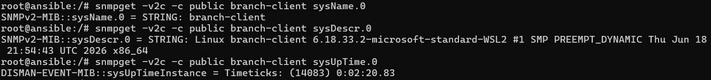
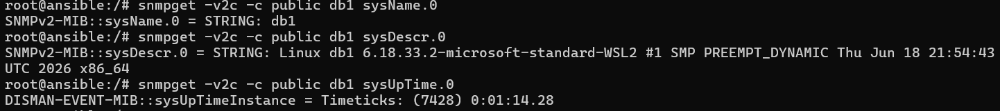

# SNMP ja verkon perustason valvonta

## Johdanto

SNMP (Simple Network Management Protocol) on verkonhallinta protokolla, jota käytetään  verkkolaitteiden valvontaan ja tiedonkeruuseen. Tietoa voidaan kerätä esimerkiksi kytkimistä, reitittimistä, palvelimista ja muista verkkolaitteista. SNMP perustuu SNMP-agentin ja SNMP-managerin väliseen tiedonvaihtoon. Manageri suorittaa kyselyitä ja agentti puolestaan kerää tietoa ja vastaa kyselyihin. Tietoa kerätään esimerkiksi laitteiden resurssien käytöstä ja käynnissäoloajasta tai verkkoliitäntöjen tilasta ja tiedonsiirrosta. SNMP:tä käytetään siis verkon valvonnan lisäksi, vianmääritykseen ja verkon turvallisuuden varmistamiseen.

Management Information Base (MIB) toimii vuorostaan SNMP:n hallintatietojen tietorakenteena. MIB määrittelee mitä tietoja verkkolaitteesta voidaan kerätä. Jokaisella tiedolla on yksiselitteinen tunniste, eli Obejct Identiefier (OID). MIB:t tarjoavat standardoidun tavan kuvata verkkolaitteiden hallintatietoja, mikä mahdollistaa yhteentoimivuuden eri valmistajien laitteiden välillä. 

## Asennus

Asennettiin SNMP-agentti web1-palvelimen käyttöön.
Web1-palvelimelle kirjauduttiin komennolla **docker exec -it clab-hamk-verkonhallinta-golden-web1 bash**.

Ennen SNMP-agentin asennusta ajettiin komento
**sudo apt update**. Tämä komento hakee
arkistoista pakettiluettelot ja tarkistaa saatavilla olevat viimeisimmät versiot paketeista
ja niiden riippuvuuksista.

Varsinainen SNMP agentin asennus suoritettiin komennolla **apt install snmp snmpd -y**.
**Snmp** paketti asentaa komentorivityökalut, kuten **snmpget** ja **snmpwalk** ja **snmpd** vuorostaan asentaa agentin.

### SNMP-konfigurointi

Palvelun tila tarkistettiin komennolla **service status snmpd**. Palvelu ei ollut vielä käynnissä, joten tehtiin muutoksia etc/snmp-hakemistosta löytyvään agentin
konfiguraatiotiedostoon Nano-tekstieditorilla.  Tiedostoa päästiin muokkaamaan komennolla **nano etc/snmp/snmpd.conf**. 
Varmistettiin, että yhteisön nimenä oli public. Voidaan myös määritellä lisää näkyvyyttä käyttäjälle lisäämällä view systemonly included 1.3.6.1.2, eli lisätään näkymärakenteeseen korkeamman tason OID-ympäristö. SNMP-agentti sidottiin management-verkon verkkokorttiin muuttamalla agentAddress udp:172.20.20.5:161.

Käynnistettiin SNMPD-palvelu uudelleen komennolla **service snmpd restart**. Tarkistettiin palvelun tila jälleen komennolla **service status snmpd**. Saatiin ilmoitus, että snmpd is running. 

## Kerätyt tiedot

Kerättiin tietoja järjestelmästä suorittamalla SNMP-kyselyitä SNMP-agentilta.
Ensimmäiseksi hankittiin tietoa järjestelmän nimestä komennolla **snmpget -v2c -c public web1 sysName.0**. Komentotulosteesta selviää, että järjestelmän nimi on web1.

Seuraavaksi haettiin tarkempaa tietoa järjestelmästä. Tulosteesta selviää, että käytössä on Linux-käyttöjärjestelmä Windowsin WSL 2-ympäristössä ja kernelin versio 6.18.33.2, SMP PREEMPT_DYNAMIC.

Selvitettiin vielä järjestelmän käynnissäoloaika. Tulosteesta selviää, että järjestelmä on ollut käynnissä 23577 sadasosasekuntia eli 3 minuuttia ja 55,77 sekuntia.

## Verkkorajapinnat

Tutkittiin järjestelmän verkkorajapintoja komennolla **snmpwalk -v2c -c public web1 ifDescr**. Löydettiin kaksi verkkorajapintaa lo ja eth0.
Lo viittaa sisäiseen verkkoliitäntään, loopback-liitäntään. Tarkistettiin vielä verkkoliitäntöjen ip-osoitteet komennolla **snmpwalk -v2c -c public web1 ipAdEntifIndex**. Tuloksista selvisi, että eth0-rajapinnan ip-osoite on 172.20.20.5 ja kyseinen rajapinta yhdistää laitteen verkkoon. 

## OID-analyysi

Selvitettiin OID-objektien, sysName, sysDescr, sysUptime, ifDescr ja ifOperStatus käyttötarkoitus MIB-hakemistosta, osoitteesta: https://mibs.observium.org/. SysName, sysDescr ja sysUptime kuuluvat MIB-tietorakenteen System-ryhmään, jotka sisältävät yleistä tietoa järjestelmästä. SysName yksilöi laitteen nimen ja sysDescr antaa perustietoja laitteesta, kuten laitetyypistä. SysUptimen avulla voidaan vuorostaan seurata laitteen käynnissäoloaikaa ja havaita mahdollisia uudelleenkäynnistyksiä.

Objektit IfDescr ja ifOperSatus kuuluvat interface-ryhmään eli verkkoliitäntäryhmään. IfDescr kuvaa verkkoliitäntää sanallisesti ja IfOperStatus kertoo verkkoliitännän toiminnallisen tilan palauttamalla esimerkiksi arvon 1 = up/toiminnassa 2 = down/ei toiminnassa 3 = testing. 

|OID|Tarkoitus|
|:----|:----------|
|sysName.0|Hallittavan laitteen nimi|
|sysDescr.0|Kuvaus laitteen perustiedoista, kuten laitteistotyypistä, käyttöjärjestelmästä ja verkko-ohjelmistosta|
|sysUpTime.0|SNMP-agentin hallinnoiman järjestelmän käynnissäoloaika edellisestä uudelleenkäynnistyksestä|
|ifDescr|Verkkoliitännän sanallinen kuvaus.|
|ifOperStatus|Verkkoliitännän toiminnallinen tila|

SNMP-agentti asennettiin myös tietokantapalvelimelle ja sivukonttorin työasemalle. Sen jälkeen suoritettiin SNMP-kyselyitä kolmelle laitteelle: Web-palvelimelle, tietokantapalvelimelle ja branch-clientille. Tulokset on kerätty taulukkoon.

|Laite|Nimi|Käyttöjärjestelmä|Uptime|
|:----|:---|:----------------|:-----|
|web1|web1|Linux (WSL2)|0:03:55.77|
|db1|db1|Linux (WSL2)|0:01:14.28|
|branch-client|branch-client|Linux (WSL2)|0:02:20.83|

## Pohdinta

Opin tehtävässä miten SNMP:tä hyödynnetään verkkolaitteiden valvonnassa, mitä asennuksia ja muokkauksia konfiguraatiotiedostoihin täytyy tehdä, jotta SNMP-työkalu saadaan käyttöön. Opin myös MIB-tietokantojen ja OID-tunnisteiden merkityksen osana SNMP:tä. Harjoituksessa haettiin yksittäisiä tietoja laitteesta ja verkkoliitännöistä. SNMP:n varsinainen hyöty kuitenkin tulee esiin todennäköisesti, kun sitä hyödynnetään automaattisesti yksittäisten kyselyiden sijaan. 

SNMP:ssä manageri voi suorittaa kyselyitä määräajoin (polling), jolloin saadaan jatkuvaa ajantasaista dataa esimerkiksi prosessorin kuormituksesta, resurssien käytöstä tai järjestelmien tilasta. Jatkuvat kyselyt kuitenkin tuottavat liikennettä ja voivat aiheuttaa viivettä, jolloin tieto saapuu myöhässä.
SNMP trap on vuorostaan laitteen tapahtumaan sidottu ilmoitus ilman erillistä kyselyä. Se voi liittyä esimerkiksi portin toiminnallisuuden muuttumiseen tai autentikoinnin epäonnistumiseen. Trap ei vaadi vastaanottajalta kuittausta, joten se saattaa kadota matkalla kun taas SNMP Inform vaatii kuittauksen. 

SNMP:stä on olemassa useita eri versioita. SNMPv2 tarjoaa uusia komentoja edellisiin versioihin verrattuna, kuten GETBULK, jolla helpotetaan suurten tietomäärien siirtämistä. SNMPv2 muuttaa myös Trap-viestien toimintaa, niin että ne vaativat kuittauksen managerilta (SNMP INFORM). 

SNMPv2 on helppokäyttöinen, mutta sillä on kuitenkin rajoituksensa etenkin tietoturvan osalta.
SNMPv2 siirtää kaiken tiedon salaamattomana eli plain tekstinä tietoverkon yli. SNMPv2:ssa käytetään yksinkertaista autentikointia, community stringiä, joka toimii agentin ja hallintajärjestelmän välisenä "salasanana". Sen avulla voidaan määritellä myös millä oikeuksilla tietoja haetaan. Useimmiten community string on asetettu publiciksi. Community string näkyy kyselyssä kuitenkin salaamattomana, mikä aiheuttaa tietoturvaongelmia.

SNMPv3 on uudempi versio, joka mahdollistaa datan kryptaamisen ja myös käyttäjän tarkemman autentikoinnin ja autorisoinnin. Eli todentaa käyttäjän käyttäjätunnuksen ja salasanan avulla ja määrittää mihin dataan käyttäjällä on oikeus. SNMPv2 saattaa olla riittävä luotetuissa sisäverkoissa, mutta sitä ei tulisi käyttää julkisiin tai internetissä oleviin verkkoihin, sen tietoturva-aukkojen takia. SNMpv3 onkin suositeltu versio tuotantoympäristöihin.