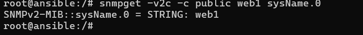
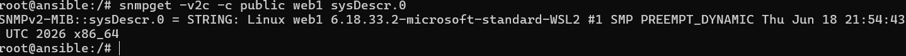
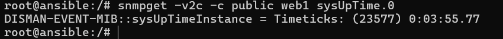
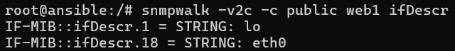
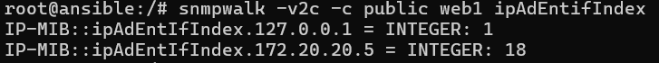

# SNMP ja verkon perustason valvonta

## Johdanto

SNMP (Simple Network Management Protocol) on verkonhallinta protokolla.

## Asennus

Asennettiin SNMP agentti web1-palvelimen käyttöön.
Web1-palvelimelle kirjauduttiin komennolla **docker exec -it clab-hamk-verkonhallinta-golden-web1 bash**

Ennen SNMP agentin asennusta ajettiin komento
**sudo apt update**. Tämä komento hakee
arkistoista pakettiluettelot ja tarkistaa saatavilla olevat viimeisimmät versiot paketeista
ja niiden riippuvuuksista.

Varsinainen SNMP agentin asennus suoritettiin komennolla **apt install snmp snmpd -y**.
**Snmp** paketti asentaa komentorivityökalut, kuten **snmpget** ja **snmpwalk** ja **snmpd** vuorostaan asentaa agentin.

### SNMP-konfigurointi

Palvelun tila tarkistettiin komennolla **service status snmpd**. Palvelu ei ollut vielä käynnissä, joten tehtiin muutoksia etc/snmp-hakemistosta löytyvään agentin
konfiguraatiotiedostoon Nano-tekstieditorilla. Tiedostoa päästiin muokkaamaan komennolla **nano etc/snmp/snmpd.conf**. 
Tarkistettiin, että yhteisön nimenä oli public. Tämä on siis se  päästään lukemaan 

## Kerätyt tiedot

Kerättiin tietoja järjestelmästä suorittamalla SNMP-kyselyitä Ansiblella.
Ensimmäiseksi hankittiin tietoa järjestelmän nimestä komennolla **snmpget -v2c -c public web1 sysName.0**. Komentotulosteesta selviää, että järjestelmän nimi on web1.

Seuraavaksi haettiin tarkempaa tietoa järjestelmästä. Tulosteesta selviää, että käytössä Linux-käyttöjärjestelmä Windpowsin WSL 2-ympäristössä ja kernelin versio 6.18.33.2, SMP PREEMPT_DYNAMIC.

Selvitettiin vielä järjestelmän käynnissäoloaika. Tulosteesta selviää, että järjestelmä on ollut käynnissä 23577 sadasosasekuntia eli 3 minuuttia ja 55,77 sekuntia.

## Verkkorajapinnat

Tutkittiin järjestelmän verkkorajapintoja komennolla **snmpwalk -v2c -c public web1 ifDescr**. Löydettiin kaksi verkkorajapintaa lo ja eth0.
Lo viittaa sisäiseen verkkoliitäntään, loopback-liitäntään. Tarkistettiin vielä verkkoliitäntöjen ip-osoitteet komennolla **snmpwalk -v2c -c public web1 ipAdEntifIndex**. Tuloksista selvisi, että eth0-rajapinnan ip-osoite on 172.20.20.5 ja kyseinen rajapinta yhdistää laitteen verkkoon. 

## OID-analyysi

Seuraavien objektien tarkoitus selvitettiin

|OID|Tarkoitus|
|:----|:----------|
|sysName.0|Hallittavan laitteen nimi|
|sysDescr.0|Kuvaus laitteen perustiedoista, kuten laitteistotyypistä, käyttöjärjestelmästä ja verkko-ohjelmistosta|
|sysUpTime.0|SNMP-agentin hallinnoiman järjestelmän käynnissäoloaika edellisestä uudelleenkäynnistyksestä|
|ifDescr|Verkkoliitännän sanallinen kuvaus|
|ifOperStatus||

|Laite|Nimi|Käyttöjärjestelmä|Uptime|
|:----|:---|:----------------|:-----|
|web1|
## Pohdinta