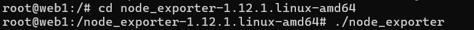
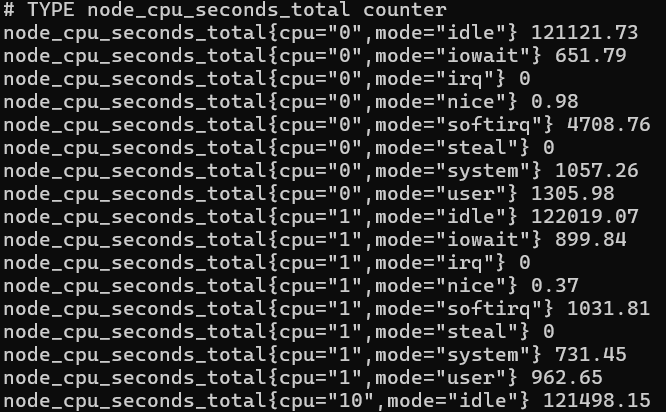
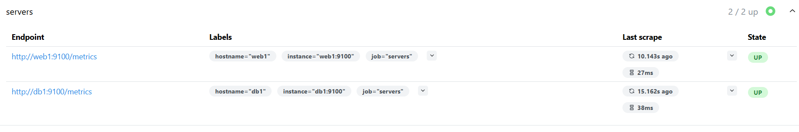
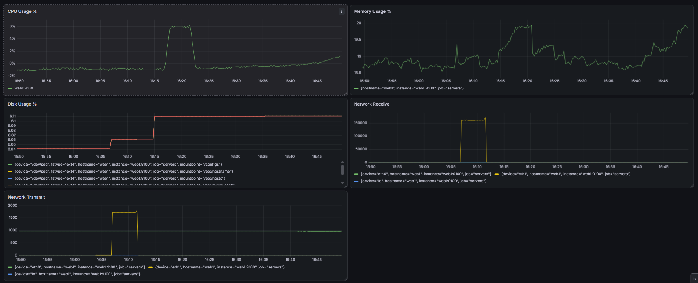
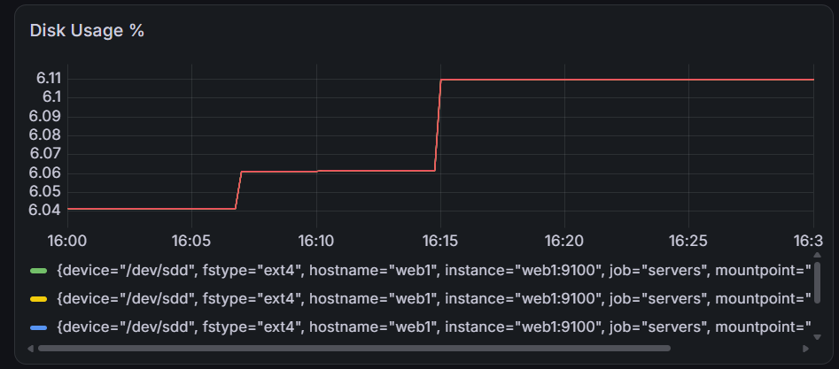
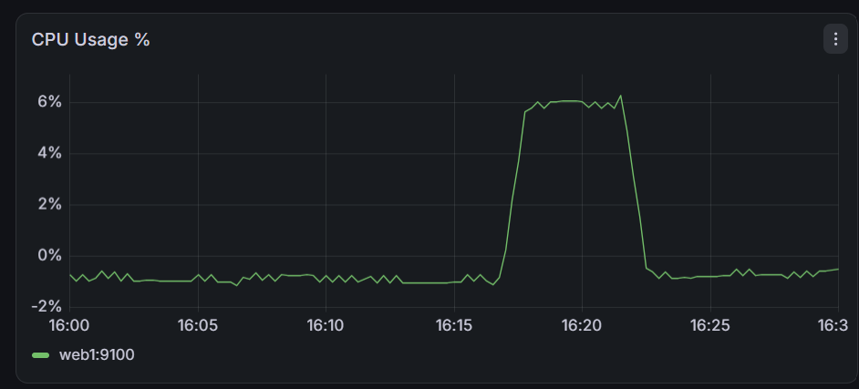
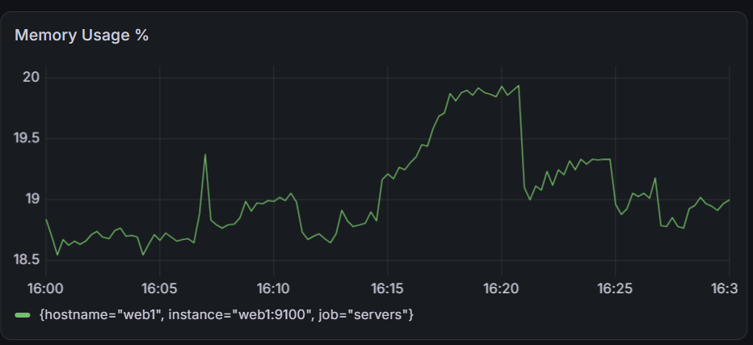

# Prometheus, Node exporter ja Grafana

## Johdanto

Monitorointi tarkoittaa jonkin prosessin tai järjestelmän jatkuvaa seurantaa ja havainnointia. Tietotekniikassa monitoroinnissa havainnoidaan esimerkiksi 
CPU-kuorman, verkkoliikenteen, muistin käytön ja suorituskyvyn muutoksia. Tarkoituksena ei ole kuitenkaan kerätä mahdollisimman paljon dataa, vaan kerätä sitä kohdennetusti tärkeimmistä kohteista riittävällä keräysvälillä. 

Monitorointi on tärkeää palveluiden ja verkkojen ylläpidossa, sillä ongelmat tulisi havaita ennen käyttäjän reagoimista niihin. Tarvitaan havainnointia normaalitasosta, jotta osataan reagoida poikkeamiin. Reaalikaisen muutoksen lisäksi seurataan siis myös historiallista dataa. Monitorointi on kokonaisuus, joka ulottuu datan keruusta aina laajemman kokonaiskuvan muodostamiseen ja analysoimiseen. Yhdistetään esimerkiksi eri mittareiden samanaikaista dataa. Monitoroinnin tarkoituksena on tukea päätöksentekoa.

Prometheus on avoimen lähdekoodin monitorointi- ja hälytystyökalu. Prometheus kerää jatkuvasti metriikkadataa eri järjestelmistä ja tallentaa kaiken tiedon aikasarjadatana.  Kyseessä ei ole yksittäinen palvelin, vaan laaja ekosysteemi, joka koostuu erilaisista komponenteista, kuten Prometheus-palvelimesta, exportereista ja push gatewaysta. Prometheus käyttää tehokasta PromQL-kyselykieltä.

## Ympäristön rakentaminen

Prometheus ei yleensä kerää tietoa suoraan käyttöjärjestelmältä, vaan käyttää exportereita. Exporterit, kuten Node exporter kerää käyttöjärjestelmältä tietoa, kuten CPU-, muisti- ja levyjärjestelmän metriikoita ja julkaisee ne HTTP-rajapinnan kautta. 

### Node exporterin käyttöönotto

Kirjauduttiin aluksi web-palvelimelle komennolla **docker exec -it clab-hamk-verkonhallinta-golden-web1 bash**.
Ennen Node exporterin asennusta päivitettiin pakettiluettelot komennolla 
**sudo apt update**. Sen jälkeen asennettiin tarvittavat työkalut komennolla **apt install wget tar -y**. 
Wget mahdollistaa tiedostojen lataamisen internetistä ja tar mahdollistaa tar.gz-tiedostojen purkamisen.

Node exporterin uusin versio selvitettiin GitHubista ja asennettiin se komennolla:

**wget https://github.com/prometheus/node_exporter/releases/latest/download/node_exporter-1.12.1.linux-amd64.tar.gz**

Paketti purettiin komennolla:

**tar xvf node_exporter-1.12.1.linux-amd64.tar.gz**

Siirryttiin hakemistoon ja käynnistettiin Node exporter.

Node exporterin asentamisen ja käynnistämisen jälkeen tarkistettiin, että Node Exporter vastaa ja tarjoaa metriikoita pyynnöllä
 **curl http://localhost:9100/metrics**. Komentotulosteessa näkyi suuri määrä metriikoita. 

## Yhteyksien testaaminen

### Prometheus

Avattiin Prometheus selaimessa:
http://localhost:9090

Tarkistettiin Targets-näkymästä, että Prometheus pystyy hakemaan metriikoita web-palvelimelta web1. Kohteen tila oli UP, joten yhteys toimii.

### Grafana

 Tarkistettiin myös Prometheuksen yhteys Grafanaan. Kirjauduttiin Grafanaan ja lisättiin tietolähteeksi Prometheus ja palvelimen osoitteeksi: http://prometheus:9090. Testattiin yhteyttä "save & test" -painikkeella ja saatiin ilmoitus onnistuneesta yhteydestä.

## Dashboard

Luotiin dashboard nimeltä Golden Topology Monitoring ja lisättiin sinne paneelit, jotka näyttävät seuraavia metriikoita: CPU:n käyttöaste, muistin käyttöaste, levytilan käyttöaste, verkkoliikenne (saapuva) ja verkkoliikenne (lähtevä).

CPU:n käyttöaste kertoo kuinka paljon prosessorin laskentatehosta on käytössä. Mittari auttaa esimerkiksi paljastamaan CPU-pullonkaulat. Muistin käyttöaste kertoo käytössä olevan RAM:in osuuden kokonaismuistista. Se on tärkeä toimintakyvyn mittari, sillä korkea muistin käyttöaste voi heikentää suorituskykyä tai jopa johtaa järjestelmän kaatumiseen. Levytilan käyttöaste kertoo kuinka suuri osuus levytilasta on käytössä. Dashboardista huomataan, että verkkoliikenne kulkee nyt rajapinnan eth1 kautta ja verkkoliikenteessä huomataan muutosta, kun ajetaan komento **sudo apt install stress-ng** eli ladataan paketit verkon kautta.

### Kuormitustesti

Luotiin klo 16.14 500 megatavun testitiedosto komennolla **dd if=/dev/zero of=testfile.img bs=1M count=500**. Tiedoston luominen näkyy piikkinä levytilan käyttöaste -paneelissa. Klo 16.06 piikki vuorostaan syntyi ajettuani komennon **sudo apt install stress-ng**. Kokonaiskuvan antavasta dashboardista voidaan havaita, että kuormitustesti ei aiheuta verkkoliikennettä.

Kuormitettiin CPU-ydintä 60 sekunnin ajan komennolla **stress-ng --cpu 4 --timeout 60s**. Komento ajettiin klo 16.16. Prosessorin kuormitus nousi hetkellisesti noin 6 prosenttiin. Kokonaiskuvan antavasta dashboardista voidaan havaita, että kuormitustesti ei aiheuta verkkoliikennettä.

Muistin käyttöaste kasvoi hieman kuormitustestin aikana.

## SNMP vs Prometheus

|Ominaisuus|SNMP|Prometheus|
|:---------|:---|:---------|
|Tiedonkeruu|SNMP perustuu manager-agent -malliin. Manageri suorittaa kyselyitä ja agentti puolestaan kerää tietoa ja vastaa kyselyihin.|Perustuu pull-periaatteeseen (scraping). Eli kyselee metriikat pääsääntöisesti Node exporterilta. |
|Käyttöönotto| Helppo ottaa käyttöön. SNMP:tä tukevat lähes kaikki yritysverkoissa käytettävät kytkimet, reitittimet, palomuurit ja monet palvelimet. Vaatii palvelun asentamisen ja konfiguroinnin.| Vaatii Prometheuksen ja sen komponenttien, kuten exportereiden asentamisen ja konfiguroimisen.|
|Mittarien määrä|SNMP:n kauttaa saatavilla olevat metriikat määritellään MIB-tietorakenteessa. Määrä riippuu laitteesta. |Hyvin suuri määrä metriikoita saatavilla exporteiden avulla.|
|Visualisointi|Ei ole itsessään visualisointityökalu. |Ei ole itsessään visualisointityökalu, mutta toimii hyvin mittausdatan visualisointityökalun Grafanan kanssa.|
|Hälytysmahdollisuudet|Agentit lähettävät tarvittaessa monitorointijärjestelmälle ilmoituksia trap-viestillä ilman kyselyitä ongelmatilanteissa, kun esimerkiksi CPU:n kuormitus ylittää raja-arvon.|Hälytystyökalu (Alert Manager) kuuluu ekosysteemiin.|
|Soveltuvuus pilviympäristöihin|Suunniteltu erityisesti perinteisen infrastruktuurin valvontaan. Ei suunniteltu varsinaisesti pilviympäristöihin.|Soveltuu hyvin pilviympäristöihin, palvelin- ja konttiympäristöjen lisäksi.|

## Pohdinta

Keskeisimmät mittarit, mitä ylläpitäjän tulisi seurata liittyvät kohteen saatavuuteen, resurssien käyttöön ja verkkoliikenteeseen. Ensinnäkin on hyvä tietää saadanko kohteesta dataa, eli onko kohteen tila ylhäällä (up). Resurssien käytöstä kertovat esimerkiksi CPU:n ja muistin käyttöaste. Ne ovat tärkeitä toimintakyvyn mittareita, jotka kertovat sen hetkisestä järjestelmien kuormituksesta. Jatkuva korkea muistin tai CPU:n käyttöaste voi kertoa ongelmasta tai optimoinnin tarpeesta. Sen lisäksi voidaan seurata levytilan käyttöä ja varmistaa, että levytilaa on riittävästi. Verkkoliikennettä seurattiin harjoituksessa lähtevän (transmit) ja saapuvan (receive) liikenteen osalta. Myös nämä kuuluvat keskeisimpiin mittareihin, joilla varmistetaan verkon toimivuus. Prometheuksen dokumentaatiossa korostetaan, että metriikoiden valinta riippuu aina käyttötarkoituksesta. Web-palvelimen kohdalla voi olla tärkeää seurata kuinka nopeasti palvelin vastaa pyyntöihin (request time) tai kuinka monta pyyntöä vastaanotetaan (request rate), kun taas tietokannan kohdalla voidaan seurata aktiivisten kyselyiden määrää.

Tehtävässä rakennettu dashboard antaa perustiedot infrastruktuurin terveydestä, mutta lisäisin siihen ehkä levyn I/O:ta, Uptimea ja verkkoliikenteen virhemääriä seuraavat mittarit. Jos palvelimella on HTTP-palvelu , niin lisäisin myös mittarit HTTP-pyyntöjen vastausajasta ja virhemääristä.

SNMP:tä käytetään erityisesti keräämään tietoja valmistajien infrastruktuurilaitteista. Se sopii erityisesti verkkolaitteiden ja muun infrastruktuurin valvontaan. Prometheus on puolestaan dynaamisempi käyttötarkoitukseltaan. Se on suunniteltu erityisesti palvelin-, pilvi- ja konttiympäristöjen valvontaan ja sopii erityisesti sovellusten ja palveluiden metriikoiden keräämiseen. Se perustuu tehokkaaseen ja moniulotteiseen aikasarja-tietokantaan. Se tarjoaa myös joustavan kyselykielen ja modernit hälytysominaisuudet.

 

