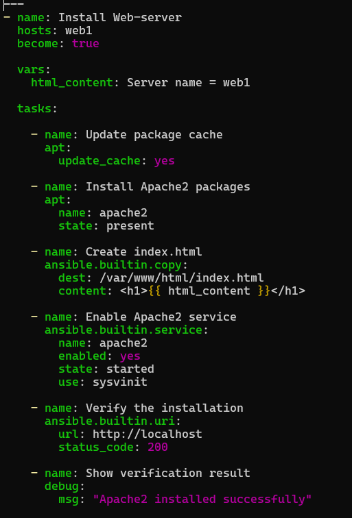
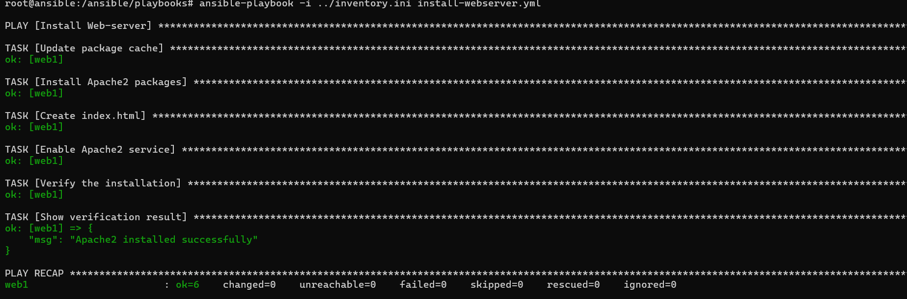
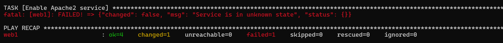

# Ansible ja Infrastructure as Code

## Johdanto

Infrastructre as Code (IaC) tarkoittaa infrastruktuurin hallintaa ohjelmakoodin avulla yksitellen suoritettavien komentojen sijaan. 

IaC tarjoaa useita etuja, kuten automatisaatiota, muutosten hallintaa, toistettavuutta, dokumentaatiota ja skaalautuvuutta. Infrastruktruurin luominen voidaan automatisoida IaC:in avulla, jolloin se on huomattavasti nopeampaa ja tehokkaampaa kuin sen rakentaminen erillisillä komennoilla. Automaatiokoodi mahdollistaa myös määritysten toistettavuuden tarvittaessa lukuisille palvelimille, mikä mahdollistaa vuorostaan ympäristön skaalautuvuuden. IaC-määritykset tallennetaan usein versionhallintaan, mikä helpottaa muutosten seuraamista, sillä niitä voi tarkastella ja niihin voi palata jälkikäteen. IaC-koodi toimii myös dokumentaationa infrastruktuurin rakenteesta ja määrittelyistä.

IaC-työkaluihin kuuluu esimerkiksi Ansible, jota käytetään tässä harjoituksessa.

## Inventory

Tutustuttiin inventoryyn komennolla **cat /ansible/inventory.ini**. Käytettiin myös osoitteesta: https://stackoverflow.com/questions/33363023/is-there-any-option-to-list-groups-in-ansibleStack löytynyttä komentoa **ansible localhost -m debug -a 'var=groups'**, jolla listattiin inventoryn ryhmät. 

Inventory sisältää kaikki yritysverkon laitteet, joihin ollaan perehdytty aikaisemmilla viikoilla: r1, r2, r3, client1, attacker, web1, db1, branch-client, prometheus, grafana, zabbix, cadvisor ja ansible.

Inventory sisältää erilaisia ryhmiä, jotka on muodostettu eri tavoilla. INI-tiedostossa ryhmät on määritely [] hakasulkeilla. Useimmat ryhmät on määritelty laitetyypin tai käyttötarkoituksen perusteella. Esimerkiksi työasemaryhmä sisältää client1, branch-client ja attacker, palvelinryhmä sisältää db1 ja web1 ja reititinryhmä reitittimet. Lisäksi on ryhmä (monitoring), joka sisältää monitoroimiseen käytetyt laitteet: prometheus, grafana, zabbix ja cadvisor ja hallinnointiin käytettyjen laitteiden ryhmä (management), joka sisältää ansiblen. 

Inventoryssä on myös loogisia ryhmiä, jotka on jaoteltu verkkosegmenttien mukaan: user_network, server_network ja branch_office. Näissä on hosteja, jotka sisältyvät jo edellisiin ryhmiin. 

Sen lisäksi ryhmiä voidaan myös yhdistää isompiin ryhmiin. Tällöin ryhmien välille muodostuu parent/child-suhde. Parent-ryhmään viittaamalla viitatataan kaikkiin ryhmään sisältyviin alaryhmiin. Parent-ryhmiä ovat *infrastructure groups*-kategoriassa network_devices-, linux-hosts-, ja ubuntu_hosts-ryhmät. Esimerkiksi linux_hosts pitää sisällään työasema-, palvelin-, monitorointi- ja hallintaryhmät.

Parent-ryhmä on muodostettu myös Prometheus monitorointiin tarkoitetuista kohteista. Eli routers, clients ja servers-ryhmät on niputettu Node-exporter parent-ryhmään. 

Ansiblen dokumentaation mukaan Ansible muodostaa myös kaksi oletusryhmää: all- ja ungrouped-ryhmät. All sisältää kaikki laitteet ja ungrouped sisältää laitteet, jotka eivät kuulu mihinkään ryhmään. Tässä harjoituksessa ungrouped on kuitenkin tyhjä, sillä kaikki laitteet kuuluvat johonkin ryhmään.

Ryhmät mahdollistavat määrittelyjen ja automatisoinnin tekemisen kohderyhmittäin esimerkiksi tietylle palvelinryhmälle. Kun Ansible suoritetaan yksittäisellä komennolla (ad-hocilla) tai playbookilla, kohteeseen viitataan *patternin* avulla. Yksittäisessä komennossa *pattern* sijaitsee toisena esimerkiksi "ansible webservers..". Playbookissa *pattern* vastaa **hosts:** sisältöä. Esimerkiksi hosts: webservers.

### Ensimmäinen playbook

Siirrytiin playbook-hakemistoon komennolla cd /ansible/playbooks. Suoritettiin komento **ansible-playbook -i ../inventory.ini ping.yml**. Playbook suorittaa ping.yml tiedoston, jossa käytetään ping-moduulia testaamaan yhteyksiä ja cli_command-moduulia suorittamaan komento: **show version**. 

Tuloksista nähdään, että kohteille attacker, branch-client, client1, db1 ja web1 saadaan yhteys. Monitoring-palvelimet prometheus, grafana, zabbix ja cadvisor sekä ansible-host eivät olleet saavutettavissa SSH-yhteydellä. Reitittimiin saatiin vuorostaan yhteys **ansible all -i /ansible/inventory.ini -m ping** komennolla, mutta komennolla **ansible-playbook -i ../inventory.ini ping.yml** show version -tehtävä epäonnistui, koska Ansible ei löytänyt tarvittavaa paramiko-kirjastoa: "fatal: [r1]: FAILED! => {"changed": false, "msg": "paramiko is not installed: No module named 'paramiko'"}".

## Esimerkkiplaybookit

Moduulit ovat Ansible playbookien rakennuspalikoita. Node-exporterin asentava playbook käyttää mm. seuraavia moduuleita: apt-, file-, get_url-, unarchive, copy-, uri- ja debug-moduulit.

Apt-moduuli on tarkoitettu pakettien hallintaan ja file-moduuli tiedostojen tai tiedostojen ominaisuuksien hallintaan. Get_url-moduuli lataa tiedostoja url-osoitteesta ja unarchive purkaa arkistoja, kuten tässä tapauksessa .tar.gz. Copy-moduuli kopioi tiedostoja haluttuun paikkaan ja debug-moduuli printtaa viestejä suorituksen aikana. Uri-moduuli vuorovaikuttaa webpalveluiden kanssa.

Sen lisäksi snmp:n asentava playbook käyttää myös service-moduulia, jota käytetään palveluiden hallinnoimiseen esimerkiksi käynnistämään tai uudelleenkäynnistämään tietty palvelu. 

Ansiblen muuttujia (vars) käytetään tallennuspaikkana varastoimaan arvoja, kuten stringejä, numeroita ja listoja, joita voidaan käyttää myöhemmin. Muuttujat tekevät playbookeista dynaamisempia. Install-node-exporter.yml-tiedostossa on esimerkiksi muuttuja node_exporter_version, johon on tallennettu haluttu versio, jota käytetään myöhemmin useassa eri paikassa.

Handlers-lohkoa käytetään ajamaan operaatioita muutosten yhteydessä. Handlerit suoritetaan, kun niitä notifioidaan käyttämällä notify-avainsanaa. Tyypillinen tilanne käyttää handlereita on esimerkiksi palvelun uudelleenkäynnistäminen konfigurointimuutosten jälkeen. Node-exporter-playbook ei tässä tapauksessa tarvitse handleria, sillä playbookissa ei ole tehtävää, joka vaatisi esimerkiksi palvelun uudelleenkäynnistämisen, kuten snmp:n yhteydessä.

## Oma playbook

Tehtiin playbook install-webserver.yml, joka asentaa web1-koneelle Apache2 web-palvelimen.
Playbook tehtiin esimerkkiplaybookien mukaisesti ja siinä käytettiin service-, apt-, copy-, uri- ja debug-moduuleita. 

## Järjestelmätiedot

Kerättiin järjestelmätietoja komennolla **ansible all -i ../inventory.ini -m setup**. Järjestelmätiedot kerättiin laitteilta, joihin saatiin yhteys.

|Laite|Käyttöjärjestelmä|Ip-osoite|Prosessorien määrä|Kokonaismuistin määrä(mb)|
|:----|:----------------|:--------|:-----------------|:--------------------|
|db1|Ubuntu|170.20.20.5|12|15854|
|branch-client|Ubuntu|170.20.20.9|12|15854|
|web1|Ubuntu|170.20.20.2|12|15854|
|client1|Ubuntu|170.20.20.6|12|15854|
|attacker|Kali|170.20.20.4|12|15854|
|r1|Ubuntu||12|15854|
|r2|Ubuntu||12|15854|
|r3|Ubuntu||12|15855|

## Vertailu

Automatisoinnin tuottaminen ja playbookin kirjoittaminen vaatii oman aikansa, mutta helpottaa huomattavasti työtaakkaa, jos täytyy suorittaa vastaavia tehtäviä useille palvelimille. Yhden palvelimen kohdalla voi olla jopa nopeampaa suorittaa komentoja erikseen, mutta useamman palvelimen kohdalla automatisointi on järkevämpi ratkaisu.

Kun tuotantoympäristö kasvaa yhä laajemmaksi on automatisointi välttämätöntä työmäärän ja virheiden vähentämiseksi. Playbook toimii myös dokumentaationa siitä, miten järjestelmä on rakentunut ja helpottaa siten järjestelmän ylläpitoa. Automatisointi on myös välttämätöntä jos on tarpeen suorittaa toimintoja automaattisesti esimerkiksi muutosten yhteydessä tai jos infrastruktuurin toimivuus, vaatii automatisointia. Yleisesti automatisonti on tarpeen, jos ympäristö vaatii tehokkuutta, tietoturvariskien minimoimista tai toimintojen optimointia.

## Yhteenveto

Tehtävä opetti ympäristön automatisoinnin perusteita Ansiblen avulla. Perehdyttiin myös inventory.INI-tiedoston rakenteeseen ja playbookien rakennuspalikoihin, moduuleihin, muuttujiin ja handlereihin. Playbookilla automatisoitiin web-palvelimen asennus. 

Tehtävä opetti myös Ansible dokumentaation tulkitsemista, sillä sitä hyödynnettiin playbookien tekemiseen. Install-webserver.yml-playbookissa tuli haasteita service-moduulin kanssa, sillä se palautti virheen "Service is in unknwon state". Red Hatissä, GitHubissa, Ansible-foorumilla ja Redditissä keskusteltiin samasta ongelmasta erityisesti Ansible docker-konttien yhteydessä. Keskusteluihin perehtymällä ilmeni, että ongelma ilmeisesti liityy tarkemmin siihen, että kontissa ei ole systemd:tä käytössä init-järjestelmänä (PID1).

Tarjottiin ratkaisua käyttää sysvinit-moduulia service-moduulin sijaan tai pakottaa käyttämään tiettyä service manageria käyttämällä avainsanaa **use:** ja sen jälkeen sysvinit. Tämä korjasi ongelman ja komentotuloste ilmoitti onnistuneesta asennuksesta.

