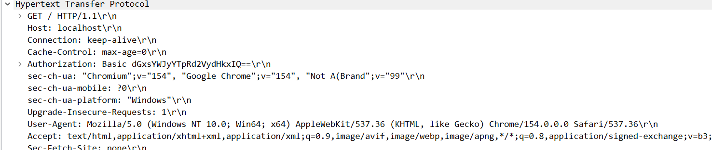
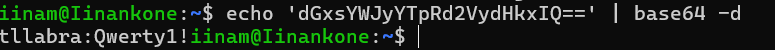

# Wireshark

## Osa 1

### Liikenteen kaappaminen yle.fi:stä

Alettiin kaappaamaan liikennettä Wiresharkilla ja mentiin https://www.yle.fi verkkosivulle. 
Suodatettiin liikennettä 'port 443' -Capture filtterillä, sillä haluttiiin nimenomaan seurata https-liikennettä.
Kokeiltiin myös liikenteen suodattamista display-filtterillä. Tällöin käytettiiin filtteriä 'tcp.port == 443'. Näillä filttereillä kaappauksia muodostui kuitenkin paljon, joten käytettiin vielä tls.handshake.type == 1 -display-filtteriä, jonka avulla löydetään TLS-kättelyn aloittavat ClientHello-paketit. Oikea paketti oli helppo paikantaa info-sarakkeen selitteen perusteella, sillä siinä luki Client Hello (SNI = yle.fi).
Avattiin paketti ja Ipv6-osion alta löytyi kohdeosoitteeseen liittyvä GeoIP-tieto. Sen perusteella palvelun tuottavan web-palvelimen sijainti on USA:ssa ja palveluntarjoaja Amazon. 

## Osa 2

### Liikenteen kaappaaminen learn.hamk.fi:stä

Kaapattiin jälleen liikennettä Wiresharkilla. Kirjauduttiin osoitteeseen learn.hamk.fi.

Selvitettiin DNS-kyselyn vastauksen IP-osoite. Ensin suodatettiin liikennettä komennolla **dns.qry.name contains "learn.hamk.fi"**. Avattiin Standard query response -paketti ja sen sisältä Domain Name System -osio. Sieltä selvisi seuraavat tiedot.
Ip:osoite 192.148.239.84
TTL: 1129 (18 minutes, 49 seconds)

Autoratiiviset DNS-palvelimet selvitettiin toisesta Standard query response -paketista, josta löysin osion Authoritative nameservers. Sieltä selvisi ns1.hamk.fi

Salattu yhteys muodostetaan TLS-kättelyllä. TLS-kättely muodostuu erivaiheista. ClientHello-viestissä selain ehdottaa mm. eri TLS-versioita, salausalgoritmeja (cipher suites), SNI:tä ja ALPN:ää. ServerHello-viestissä palvelin tekee niistä päätöksen.

Suodatettiin liikennettä komennolla **tlS** ja **ssl.handshake.ciphersuite**. Molemmilla hauilla löydettiiin ClientHello ja ServerHello -paketit learn.hamk.fi-yhteydelle. Selvisi, että learn.hamk.fi-yhteydessä käytetään TLSv1.3 protokollaa. ClientHello-paketin sisältä Transport Layer Security -osion sisältä löytyi selaimen ehdottamat 16 salausalgoritmiä (listattu alla). ServerHello -paketista selviää, että käytetty salausalgoritmi on **Cipher Suite: TLS_AES_128_GCM_SHA256 (0x1301)**.

Cipher Suites (16 suites)\
Cipher Suite: Reserved (GREASE) (0x0a0a)\
Cipher Suite: TLS_AES_128_GCM_SHA256 (0x1301)\
Cipher Suite: TLS_AES_256_GCM_SHA384 (0x1302)\
Cipher Suite: TLS_CHACHA20_POLY1305_SHA256 (0x1303)\
Cipher Suite: TLS_ECDHE_ECDSA_WITH_AES_128_GCM_SHA256(0xc02b)\
Cipher Suite: TLS_ECDHE_RSA_WITH_AES_128_GCM_SHA256 (0xc02f)\
Cipher Suite: TLS_ECDHE_ECDSA_WITH_AES_256_GCM_SHA384 (0xc02c)\
Cipher Suite: TLS_ECDHE_RSA_WITH_AES_256_GCM_SHA384 (0xc030)\
Cipher Suite: TLS_ECDHE_ECDSA_WITH_CHACHA20_POLY1305_SHA256 (0xcca9)\
Cipher Suite: TLS_ECDHE_RSA_WITH_CHACHA20_POLY1305_SHA256 (0xcca8)\
Cipher Suite: TLS_ECDHE_RSA_WITH_AES_128_CBC_SHA (0xc013)\
Cipher Suite: TLS_ECDHE_RSA_WITH_AES_256_CBC_SHA (0xc014)\
Cipher Suite: TLS_RSA_WITH_AES_128_GCM_SHA256 (0x009c)\
Cipher Suite: TLS_RSA_WITH_AES_256_GCM_SHA384 (0x009d)\
Cipher Suite: TLS_RSA_WITH_AES_128_CBC_SHA (0x002f)\
Cipher Suite: TLS_RSA_WITH_AES_256_CBC_SHA (0x0035)\

## Osa 3

Tehtävä 3 suoritettiin kokonaisuudessaan Wiresharkilla. 
Laitettiin pakettikaappaus päälle ja osoitettiin se LocalLoopback adapterille ja mentiin osoitteeseen http://localhost/:80/. Annettiin käyttäjätunnus ja salasana ja lopetettiin kaappaus.

Liikenteen suodattamiseen käytettiin display-filttereitä **http** ja **http.authorization**. Avattiin HTTP GET -pyynnön sisältä paketti, josta etsittiin Medium-artikkelin (https://mawgoud.medium.com/wireshark-101-finding-passwords-credentials-in-plain-text-traffic-0ec04ab0e014) perusteella Authorization:Basic-headeria. Tässä tehtävässä luodut verkkosivut nimittäin käyttävät HTTP Basic Authentication-todennusta, jossa käyttäjätunnukset ja salasanat ovat pelkästään Base64-koodattuja eli ne on helppo purkaa. Tunnukset onnistuttiinkiin purkamaan komennolla **echo 'Base64-koodattu-salasanajakäyttäjätunnus' | base64 -d**.

           
[Wireshark-kaappaustiedosto](week05_docker_Wireshark.pcapng)
