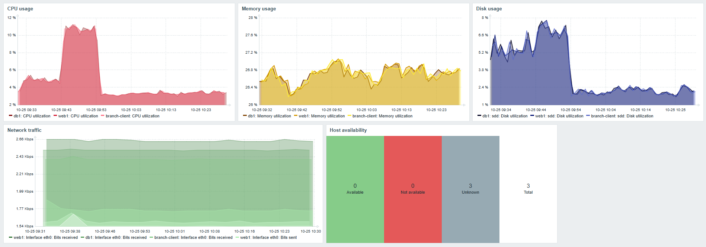
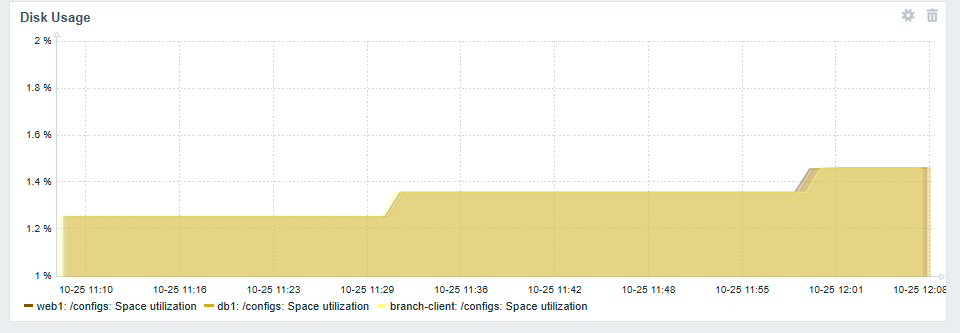
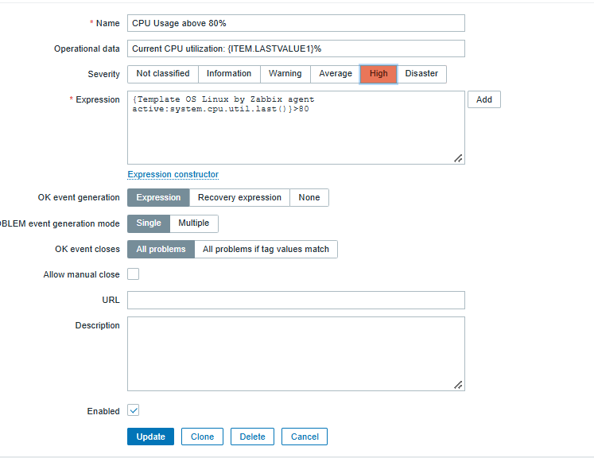
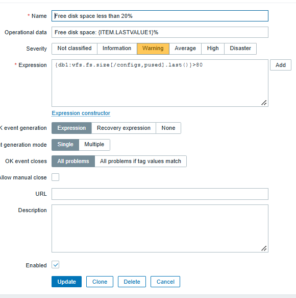
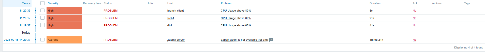

# Zabbix ja keskitetty verkonvalvonta

## Johdanto

Zabbix on avoimen lähdekoodin valvonta-alusta palvelimille, sovelluksille, tietokannoille, pilviresursseille, verkoille, sovelluksille ja virtuaalisille laitteille. 

Zabbix hyödyntää joustavaa ilmoitusmekanismia, jonka avulla käyttäjät voivat määrittää esimerkiksi sähköpostihälytyksiä erilaisista tapahtumista. Tämä mahdollistaa nopean reagoinnin mm. palvelinongelmiin. Zabbix tarjoaa myös erinomaiset datan raportointi- ja visualisointiominaisuudet.

Tiedonkeruu Zabbixissa voi tapahtua esimerkiksi agenttien, SNMP:n ja API-rajapintojen avulla.
Tämä tekee Zabbixista joustavan valvontaratkaisun, joka voidaan mukauttaa erilaisiin käyttötarkoituksiin.

Zabbixin käyttöliittymä koostuu erilaisista osista kuten hosts, templates, monitoring, dashboards, alerts ja reports. 

Hostit eli isännät ovat laitteita, joita valvotaan. Näihin kuuluvat esimerkiksi palvelimet, työasemat ja kytkimet.

Templates/malli on joukko kohteita, joita voidaan helposti liittää eri isäntiin. Näihin kohteisiin kuuluu esimerkiksi items (valvottavat kohteet ja kerättävät tiedot), triggers (laukaisimet) ja graphs (kaaviot). Mallit helpottavat myös muutosten konfiguroimista, sillä malliin tehdyt muutokset välittyvät kaikkiin niihin isäntiin, joihin kyseinen malli on liitetty.

Dashboard antaa yleiskuvan monitoroidusta ympäristöstä. Näkymää voidaan muokata tarpeiden mukaan. Dashboardin osiin kuuluu esimerkiksi kaaviot, kartat ja erilaiset luettelot ongelmista. Reports/Raportit tarjoavat yleiskuvan esimerkiksi järjestelmän tiedoista, triggereistä ja kerätystä mittausdatasta.

Monitoring-osio sisältää mm. Dashboard-näkymän, Problems (hälytykset), Latest data -mittaustiedot, Graphs-kaaviot, Maps-verkkokartat, Discovery-kohteiden etsinnän ja Services-palveluiden tilan seurannan. Näiden avulla voidaan havaita ongelmia ja tarkastella järjestelmien toimintaa.

En löytänyt käyttöliittymästä varsinaista Alerts-osiota. Mutta sillä ilmeisesti viitataan ilmoitusasetuksiin, jossa voi määritellä ylläpitäjälle lähteviä ilmoituksia tapahtumien yhteydessä.

## Hostien lisääminen

Lisättiin hosteja valvontaan. Ensimmäiseksi lisättiin web1 host.
Ensin asennettiin Zabbix-agentti Zabbixin sivuilta, josta saatiin valmiit asennusohjeet ja asennustiedostot. Käytiin myös muokkaamassa Zabbix-agentin konfiguraatiotiedostoja: Muutettiin hostnimeksi web1, lisättiin Serveriin hallintaverkko eli annettiin oikeuksia hallintaverkkoon ja lisättiin ServerActiveen Zabbix-palvelun ip-osoite eli määriteltiin agentille aktiivinen rajapinta.

Zabbixin puolella luotiin host Configuration- ja niin edelleen hosts-välilehdellä klikkaamalla Create host -painiketta. Lisättiin hostin nimi, ryhmän nimi (Containerlab hostit) ja ip-osoite. 

Hostit db1 ja branch-client lisättiin samaan tyyliin kuin web1. 
Kun agentti käynnistettiin, uudet asetukset tulivat käyttöön ja laitteet alkoivat lähettää valvontatietoja Zabbixiin.

## Dashboard

Luotiin dashboard Golden Topology Status. Dashboard seuraa CPU-kuormaa, muistinkäyttöä, levytilan käyttöä, verkkoliikennettä ja hostien tilaa.
Huomattiin jälkikäteen, että oikea mittari levytilan käytön seuraamiseen löytyy item keyllä **vfs.fs.size** ja alun perin dashboardissa ollut mittari, mittaa levytilan kuormitusta. Oikea mittari on lisätty alle.

## Mittarit
|Mittari|db1 arvo|web1 arvo|branch-client arvo|Mitä kertoo|Merkitys|
|:------|:-------|:--------|:-----------------|:----------|:-------|
|CPU Utilization|3.6292%|3.7096%|3.7371%|Kuvaa prosessorin toimintaa eli kuinka suuri osuus prosessorin suorituskyvystä on aktiivisessa käytössä|Liian suuri käyttöaste viittaa usein heikentyneeseen suorituskykyyn|
|Memory Utilization|26.17%|26.02%|26.06%|Kertoo käytössä olevan RAM:in osuuden kokonaismuistista|Mahdollistaa reagoimisen muistin aiheuttamaan resurssipulaan ja suorituskykyä heikentäviin olosuhteisiin|
|Load Average|0.3999|0.4058|0.4346|Kuvaa järjestelmän keskimääräistä työkuormaa. Prosesseja, jotka ovat parhaillaan suorituksessa tai odottavat suorittamista|Sen avulla voidaan arvioida onko laitteen kuormitus lähestymässä käytettävissä olevia rajoja|
|Uptime|00:42:22|00:42:36|00:42:16|Kuinka kauan palvelin on ollut käynnissä|Mittari varmistaa, että palvelut ovat käynnissä ja saatavilla|
|Disk Utilization|4.78%|5.8133%|6.1334%|Kuinka suuri osa levytilasta on käytössä|Sen seuraaminen ehkäisee levytilan loppumisen ja järjestelmän hidastumisen|

## Triggerit

Luotiin ensimmäiseksi CPU:n kuormitukseen liittyvä triggeri. Triggeri luotiin Zabbixin dokumentaation mukaisesti. Triggeri liitettiin templaten avulla kaikille kolmelle hostille. Ehto luotiin 'Add'-toiminnon avulla. Vakavuusluokaksi valittiin korkea.

Toinen triggeri luotiin kokeilu mielessä pelkästään db1-hostille. Item-valikosta ei löydetty suoraan free-disk-space kohdetta, joten triggerin ehto määriteltiin levyn käyttöaste-mittarin avulla. 

## Hälytys- ja häiriötestit

### Vaihtoehto A

Suoritettiin CPU-kuormitusta komennolla **yes > /dev/null & yes > /dev/null**.
Hälytys muodostui muutamassa sekunnissaa kuormituksen aloitettua.

Pysäytettiin pavelu service apache2 stop. Toiminto ei kuitenkaan aiheuttanut hälytystä nykyisillä valvonta-asetuksilla. Kun web1 liitettiin template, Apache by HTTP, hälytys muodostui.

## Vertailu

|Ominaisuus|SNMP|Prometheus|Zabbix|
|:---------|:---|:---------|:-----|
|Tiedonkeruu|SNMP perustuu manager-agent -malliin. Manageri suorittaa kyselyitä ja agentti puolestaan kerää tietoa ja vastaa kyselyihin.|Perustuu pull-periaatteeseen (scraping). Eli kyselee metriikat pääsääntöisesti Node exporterilta.|Kerää tietoa pääasiassa agenttien avulla, jotka voivat joko lähettää mittaustietoja palvelimelle tai vastata sen tekemiin kyselyihin. Erillisverkoissa ja pilviympäristöissä voidaan käyttää proxy-palvelimia, jotka keräävät ja välittävät tietoja turvallisesti Zabbix-serverille esimerkiksi VPN-yhteyden kautta. Tiedonkeruu onnistuu myös SNMP:n, API-rajapintojen, valmiiden integraatioiden ja omien skriptien avulla.|
|Dashboardit|SNMP ei itsessään tarjoa dashboardeja, vaan tiedot visualisoidaan erillisellä valvontatyökalulla.|Ei sisällä itsessään dashboardeja, mutta toimii hyvin mittausdatan visualisointityökalun Grafanan kanssa.|Sisältää valmiin käyttöliittymän, dashboardit, kuvaajat ja karttanäkymät valvottaville kohteille.|
|Hälytykset|Agentit lähettävät tarvittaessa monitorointijärjestelmälle ilmoituksia trap-viestillä ilman kyselyitä ongelmatilanteissa, kun esimerkiksi CPU:n kuormitus ylittää raja-arvon.|Hälytystyökalu (Alert Manager) kuuluu ekosysteemiin.|Sisältää triggerit, ongelmatapahtumien seurannan ja ilmoitusten lähettämisen esimerkiksi sähköpostilla tai discordilla.|
|Käyttöönotto| Helppo ottaa käyttöön. SNMP:tä tukevat lähes kaikki yritysverkoissa käytettävät kytkimet, reitittimet, palomuurit ja monet palvelimet. Vaatii palvelun asentamisen ja konfiguroinnin.| Vaatii Prometheuksen ja sen komponenttien, kuten exportereiden asentamisen ja konfiguroimisen.|Käyttöönotto vaatii palvelimen, hostien ja mittareiden konfiguroinnin.|
|Skaalautuvuus|Soveltuu kasvaviin ja monimutkaisiin verkkoihin. On kuitenkin huomattava, että SNMP:n liiallinen käyttö tai liian tiheä tiedonkeruu voi kuormittaa verkkoa ja aiheuttaa merkittävää ylimääräistä kuormitusta.|Skaalausta voi tehdä lisäämällä palvelimen resursseja tai käyttämällä useita Prometheus-instansseja. Suurissa ympäristöissä skaalautuvuutta voidaan parantaa esimerkiksi Thanos- tai Cortex-työkaluilla.|Zabbix-rakennetta voidaan skaalata helposti eri kokoisiin ratkaisuihin .|
|Yrityskäyttö|On laajalti käytetty protokolla verkkolaitteiden valvontaan ja hallintaan. |Yleinen erityisesti pilviympäristöissä, palvelin- ja konttiympäristöjen lisäksi.|Soveltuu laajasti yritysten palvelinten, verkkolaitteiden, sovellusten ja infrastruktuurin keskitettyyn valvontaan.|

## Yhteenveto

Keskitetty valvonta helpottaa palvelimien, verkkolaitteiden ja sovellusten seuraamista yhdestä paikasta sekä nopeuttaa ongelmien havaitsemista ja niihin reagointia. Tärkeimpiä mittareita ovat suorittimen ja muistin käyttö, vapaa levytila, verkkoyhteydet ja palveluiden saatavuus. Näitä käsiteltiin jo viikolla kolme. Ylläpitäjän olisi hyvä saada hälytys ainakin palvelun pysähtymisestä, palvelimen tavoittamattomuudesta ja erilaisten resurssien loppumisesta.

Prometheusta käyttäisin erityisesti pilvinatiiveihin ympäristöihin ja konttiympäristöjen suorituskykymittareiden keräämiseen ja analysointiin. Prometheus sopii myös dynaamisiin ympäristöihim, joissa palveluiden määrä muuttuu jatkuvasti. Zabbix sopii puolestaan perinteisten virtuaalikoneiden, fyysisten palvelimien ja verkkolaitteiden valvontaan ja ympäristöihin, joissa tarvitaan agenttipohjaista valvontaa. Zabbix tarjoaa yhden kokonaisvaltaisen tuotteen, kun Prometheusta tyypillisesti yhdistellään erillaisiin työkaluihin.

Valvontatoimintoihin lisäisin  uptimen, levyn I/O-kuormituksen ja lokien valvonnan sekä automaattiset hälytykset sähköpostiin. 

